# Desktop Widgets for Home Assistant

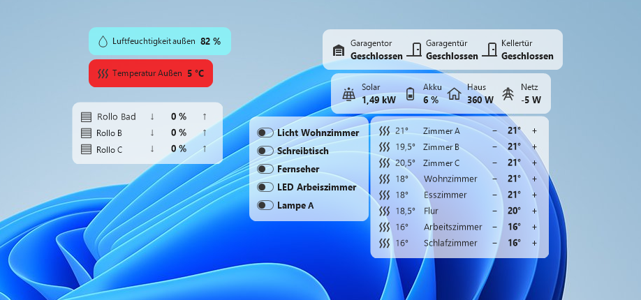

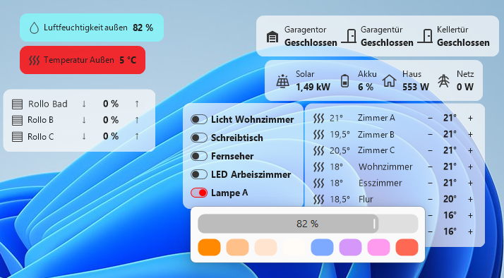

Unabhängige Windows-App für Home Assistant. Die Widgets liegen frei positionierbar auf dem Desktop. Das Programm-Icon im Infobereich öffnet per Rechtsklick das Menü **Widget hinzufügen**.

**Aktuell ist Version 1.0.1 · Build 2411.10.** Die App ist auf Deutsch und Englisch verfügbar. Die Sprache lässt sich in den Programmeinstellungen wählen.

## Windows-Widgetboard

Die MSIX-Ausgabe bietet unter Windows 11 ein natives **Home Assistant**-Widget für das Widgetboard. Die frei positionierbaren Desktop-Widgets sind weiterhin über das Infobereichssymbol verfügbar.

1. In der App unter **Einstellungen → Verbindung einrichten…** mit Home Assistant verbinden.
2. Unter **Einstellungen → Windows-Widgetboard…** bis zu drei Entitäten auswählen und speichern. Sensoren und Binärsensoren zeigen ihren Zustand an. Schalter, Lampen, Helfer vom Typ `input_boolean` und Ventilatoren lassen sich ein- und ausschalten.
3. Das Windows-Widgetboard über die Taskleiste oder mit **Windows + W** öffnen und **Home Assistant** hinzufügen.

Das Widget aktualisiert die Werte beim Öffnen und alle 15 Sekunden, solange es aktiv ist. Windows zeichnet die Karte in der aktuellen Anzeigeskalierung und im gewählten Windows-Design.

Unter **Einstellungen → Windows-Widgetboard… → Neue Kachel** lassen sich weitere Home-Assistant-Kacheln mit eigenem Namen und eigener Entitätsauswahl speichern. Im Board für jede Kachel erneut **Home Assistant** hinzufügen. Über **… → Widget anpassen** lässt sich die Zuordnung ändern. Beide Widget-Typen bieten **Klein**, **Mittel** und **Groß**.
In den Widgetboard-Einstellungen lässt sich pro Home-Assistant-Kachel unter **Darstellung** zwischen **Liste** und **Große Werte** wählen. Kontakte mit einer passenden Home-Assistant-Geräteklasse zeigen **Offen** oder **Geschlossen** an.
Entitäten vom Typ `button` und `input_button` lösen auf der Kachel über **Drücken** die zugehörige Home-Assistant-Aktion aus.

Als zweites Widget steht **Solaranlage** zur Auswahl. Es zeigt PV-Erzeugung, Hausverbrauch und Akkustand in der Anordnung der Echo-Show-Kachel. Die Sensoren werden in den Einstellungen der frei platzierbaren **Solar**-Kachel ausgewählt. Für **PV + BKW** dort einen Sensor für die gemeinsame Erzeugung wählen.
Unter **Einstellungen → Windows-Widgetboard… → Solaranlage · Nachkommastellen** lässt sich jeder Messwert automatisch oder mit 0 bis 6 Nachkommastellen anzeigen.

### Bilder aus der lokalen Widgetboard-Vorschau

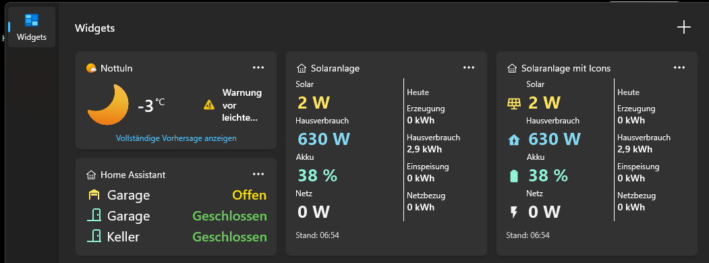

| Schalter | Sensoren |
| --- | --- |
| 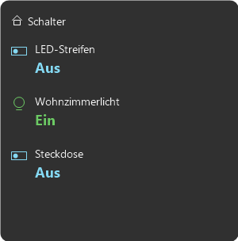 | 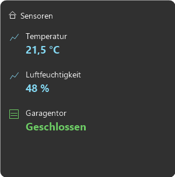 |

| Schalter und Sensoren | Solaranlage |
| --- | --- |
| 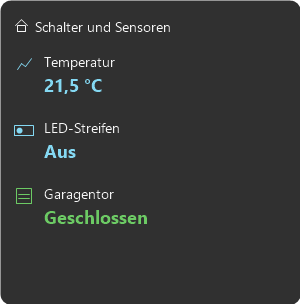 | 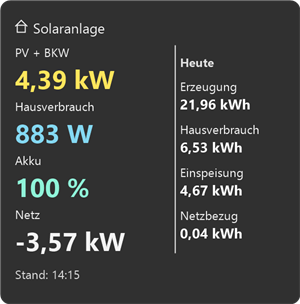 |

[Weiterer Screenshot der Solaranlage im Widgetboard](docs/screenshots/windows-widgetboard-solaranlage.png)

## Automatisch einblenden, wenn eine Tür oder ein Garagentor offen ist

Das Fenster-Tür-Widget muss nicht dauerhaft Platz auf dem Desktop belegen: Sobald mindestens ein ausgewählter Kontakt offen ist, erscheint es automatisch. Sind alle Kontakte wieder geschlossen, verschwindet es wieder. Das funktioniert beispielsweise mit einem Garagentor, einer Kellertür oder einem Fensterkontakt.

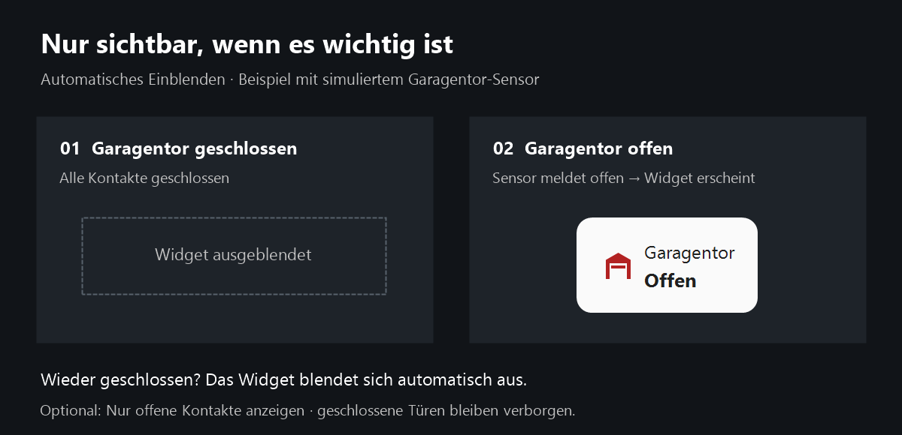

*Beispieldarstellung mit simuliertem Sensorzustand und der tatsächlichen Widget-Darstellung der App.*

1. Ein **Fenster-Tür-Sensoren**-Widget hinzufügen und den gewünschten Kontakt aus Home Assistant auswählen, zum Beispiel **Garagentor**.
2. In den Widget-Einstellungen **Nur anzeigen, wenn mindestens ein Kontakt offen ist** aktivieren.
3. Optional **Nur offene Kontakte anzeigen** aktivieren: Dann bleibt beispielsweise eine geschlossene Kellertür verborgen, während das offene Garagentor angezeigt wird.
4. Optional unter **Beim Einblenden im Vordergrund** eine Dauer festlegen, damit der Hinweis beim Öffnen kurz über anderen Fenstern erscheint. Vordergrund- und Blinkfunktionen sind standardmäßig ausgeschaltet.

English: The window and door widget can appear automatically when a selected garage door, door or window opens, and hide again when all contacts are closed. Enable **Show only when at least one contact is open**. Enable **Show only open contacts** to hide the closed contacts within the widget as well.

## Weitere Funktionen
- **Einzelne Feldbreiten:** In der Live-Vorschau lassen sich die blauen Trennlinien ziehen, um Felder unabhängig voneinander breiter oder schmaler zu machen. Schrift und Symbole behalten ihre Größe. Die Feldbreiten werden pro Widget gespeichert.
- **Ruhige Messwertanzeige:** Eine feste Breite verhindert Größenänderungen bei wechselnden Werten.
- **Nur offene Kontakte:** Geschlossene Kontakte können im Fenster-Tür-Widget ausgeblendet werden. Ausgeblendete Widgets lassen sich beim Konfigurieren vorübergehend sichtbar machen.
- **Aufmerksamkeit nach Wunsch:** Einstellbare Vordergrundintervalle, Blinkanzahl und Blinkdauer sowie eine begrenzte Vordergrundzeit beim Einblenden. Diese Funktionen sind standardmäßig deaktiviert.
- **Horizontal zentrieren:** Das Rechtsklickmenü kann ein Widget auf dem Bildschirm zentrieren, ohne seine Höhe zu ändern.
- **Bedingte Sichtbarkeit:** Das Fenster-Tür-Widget kann automatisch erscheinen, sobald mindestens ein Kontakt offen ist.
- **Feste Ausrichtung:** Pro Widget kann bei einer Breitenänderung die linke Kante, die Mitte oder die rechte Kante fest bleiben.
- **Positionssperre:** Per Rechtsklick auf eine Kachel lässt sich das Verschieben sperren. Die Einstellung wird pro Widget gespeichert.

English: Customizable Windows desktop widgets for Home Assistant. Drag the blue dividers in the live preview to adjust individual field widths without scaling text or icons. Field widths are saved per widget. View sensor readings and control lights, heating and roller shutters. Choose a fixed edge or center for resizing, lock widget positions, and show the window and door widget only when a contact is open.

- **Solar** zeigt PV-Leistung, Akkustand, Hausverbrauch und Netzleistung.
- **Felder ausblenden** in den Solar-Einstellungen legt Grenzwerte oder Bereiche pro Feld fest. Wenn alle Felder ausgeblendet sind, öffnet **Widget hinzufügen → Solar** die Ausblendbedingungen.
- **Fenster-Tür-Sensoren** zeigt Öffnungszustände mit passenden Symbolen für Fenster, Türen und Garagentore.
- **Schalter** zeigt Ein-/Aus-Zustände und schaltet Geräte per Klick. Mehrere Schalter-Widgets lassen sich getrennt einrichten. Ein Klick auf einen Lampennamen öffnet den Dimmer und bei kompatiblen Lampen die Farbauswahl. Weitere Geräteaktionen sind über das Rechtsklickmenü verfügbar.

- **Heizung** zeigt Ist- und Solltemperatur von Home-Assistant-Thermostaten und ändert die Solltemperatur auf ausdrücklichen Klick.

- **Rollläden** öffnen und schließen per Pfeiltaste. Kompatible Rollläden lassen sich im Rechtsklickmenü anhalten. Die Zahl in der Mitte zeigt den Schließgrad. Bei Geräten mit Positionsvorgabe lässt sich dort direkt ein Wert von 0 bis 100 eingeben und mit Enter bestätigen.

- **Sensoren** lassen sich in mehreren frei benennbaren Kacheln kombinieren. Pro Sensor können Name, Icon, Einheit und Dezimalstellen eingestellt werden. Die Werte lassen sich unter oder neben der Bezeichnung anzeigen.

Sensoren lassen sich aus Home Assistant auswählen. Die Widgets bieten eine Live-Vorschau für Schrift, Farben, Transparenz, Symbolgröße und Abstände. Positionen werden getrennt nach Monitoraufstellung, Auflösung und lokaler oder RDP-Sitzung gespeichert.

## Screenshots

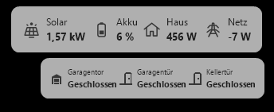

### Solar

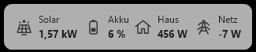

### Fenster-Tür-Sensoren

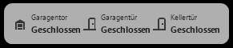

### Schalter

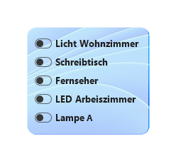

### Heizung

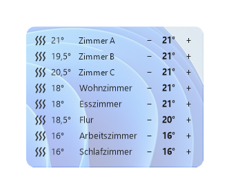

### Rollläden

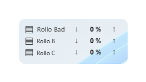

### Sensor · Luftfeuchtigkeit

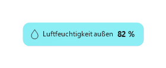

### Sensor · Außentemperatur

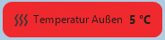

## Einstellungen sichern

Unter **Rechtsklick auf das Programm-Icon → Einstellungen** exportiert **Einstellungen sichern…** die Widget-Konfiguration, Positionen und Solar-Sensorzuordnungen als JSON-Datei. Die Home-Assistant-Adresse und der Zugriffstoken bleiben lokal. Zielinstallation zuerst mit Home Assistant verbinden, dann **Einstellungen wiederherstellen…** wählen und die App erneut starten.

In denselben Programmeinstellungen lässt sich der Windows-Autostart verwalten. Die Store-Ausgabe öffnet dafür die Windows-Seite für Autostart-Apps.

## Bauen und starten

Unter Windows **Build.cmd** ausführen. Das Skript verwendet den .NET-Framework-Compiler und erzeugt **DesktopWidgetsForHomeAssistant.exe** sowie **DesktopWidgetsForHomeAssistant-Setup.exe**. Der Installer richtet die App im aktuellen Windows-Konto ein. Die Programmdatei kann auch direkt gestartet werden.

In den Einstellungen die eigene Home-Assistant-Adresse und einen langlebigen Zugriffstoken eintragen. Die App ruft Zustände über die [Home-Assistant-REST-API](https://contributors.home-assistant.io/core/internals/rest-api/#states) ab. Eine gemeinsame WebSocket-Verbindung meldet Zustandsänderungen sofort. Bei Verbindungsproblemen läuft die regelmäßige Abfrage alle 15 Sekunden weiter. Der Token wird lokal mit Windows DPAPI verschlüsselt.

## Symbole

Die Material Design Icons von Pictogrammers unterliegen [Apache 2.0](MDI-LICENSE.txt). Die verwendeten Symbole sind in [MDI-NOTICE.txt](MDI-NOTICE.txt) aufgeführt.
## Microsoft Store

[Desktop Widgets for Home Assistant im Microsoft Store herunterladen](https://apps.microsoft.com/detail/9nz0l6dnzmmk?hl=de-DE&gl=DE)

Die Store-Ausgabe richtet beim ersten Start eine eigene Home-Assistant-Verbindung mit leeren Feldern ein. Nach dem Verbinden lassen sich Widgets über das Programm-Icon im Infobereich hinzufügen. Die Store-Ausgabe verwendet ein eigenes lokales Profil. Hinweise zur Datenspeicherung stehen in der [Datenschutzerklärung](docs/datenschutz.md).

Zum Paketieren werden das Windows SDK mit MakeAppx und das .NET 8 SDK benötigt. Der erste Build lädt das Windows App SDK über NuGet. Für Store-Pakete die Paketidentität und die Herausgeberdaten aus Partner Center verwenden.

    powershell -NoProfile -File Store\Build-Msix.ps1 -IdentityName "PAKETNAME" -Publisher "CN=HERAUSGEBER-ID" -PublisherDisplayName "HERAUSGEBERNAME"

Das Paket liegt anschließend im Ordner `artifacts`. Ohne `-Architecture` wird für x64 gebaut. Für ARM64 bzw. 32-Bit-Windows `-Architecture arm64` bzw. `-Architecture x86` angeben. Die MSIX-Version für ein Store-Update lässt sich über `-PackageVersion` setzen. Für eine lokale Installation wird ein vertrauenswürdig signiertes MSIX oder eine registrierte Entwicklerinstallation benötigt.
