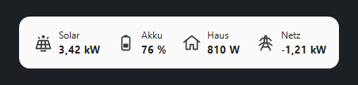
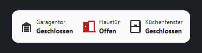
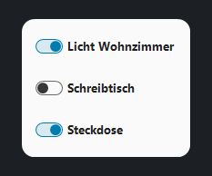
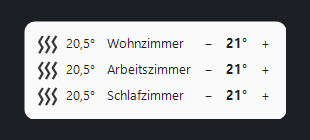
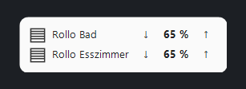
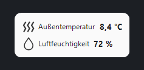

# Desktop Widgets for Home Assistant

Unabhängige Windows-App für Home Assistant. Die Widgets liegen frei positionierbar auf dem Desktop. Das Programm-Icon im Infobereich öffnet per Rechtsklick das Menü **Widget hinzufügen**.

- **Solar** zeigt PV-Leistung, Akkustand, Hausverbrauch und Netzleistung.
- **Fenster-Tür-Sensoren** zeigt Öffnungszustände mit passenden Symbolen für Fenster, Türen und Garagentore.
- **Schalter** zeigt Ein-/Aus-Zustände und schaltet steuerbare Entitäten per Klick. Die Anzeige kann waagerecht oder senkrecht angeordnet werden.

- **Heizung** zeigt Ist- und Solltemperatur von Home-Assistant-Thermostaten und ändert die Solltemperatur auf ausdrücklichen Klick.

- **Rollläden** öffnen und schließen per Pfeiltaste. Die Zahl in der Mitte zeigt den Schließgrad. Bei Geräten mit Positionsvorgabe lässt sich dort direkt ein Wert von 0 bis 100 eingeben und mit Enter bestätigen.

- **Sensoren** lassen sich in mehreren frei benennbaren Kacheln kombinieren. Pro Sensor können Name, Icon, Einheit und Dezimalstellen eingestellt werden. Die Werte lassen sich unter oder neben der Bezeichnung anzeigen.

Sensoren lassen sich aus Home Assistant auswählen. Die Widgets bieten eine Live-Vorschau für Schrift, Farben, Transparenz, Symbolgröße und Abstände. Namen, Reihenfolge und Positionen werden lokal gespeichert.

## Screenshots

Alle Anzeigen verwenden Beispieldaten.

| Solar | Fenster-Tür-Sensoren |
| --- | --- |
|  |  |

**Schalter in senkrechter Anordnung**

## Bauen und starten

Unter Windows **Build.cmd** ausführen. Das Skript verwendet den .NET-Framework-Compiler und erzeugt **SolarKachel.exe** sowie **SolarKachel-Setup.exe**. Der Installer richtet die App im aktuellen Windows-Konto ein. Die Programmdatei kann auch direkt gestartet werden.

In den Einstellungen die eigene Home-Assistant-Adresse und einen langlebigen Zugriffstoken eintragen. Die App ruft Zustände über die [Home-Assistant-REST-API](https://contributors.home-assistant.io/core/internals/rest-api/#states) ab. Eine gemeinsame WebSocket-Verbindung meldet Zustandsänderungen sofort. Bei Verbindungsproblemen läuft die regelmäßige Abfrage alle 15 Sekunden weiter. Der Token wird lokal mit Windows DPAPI verschlüsselt.

## Symbole

Die Material Design Icons von Pictogrammers unterliegen [Apache 2.0](MDI-LICENSE.txt). Die verwendeten Symbole sind in [MDI-NOTICE.txt](MDI-NOTICE.txt) aufgeführt.